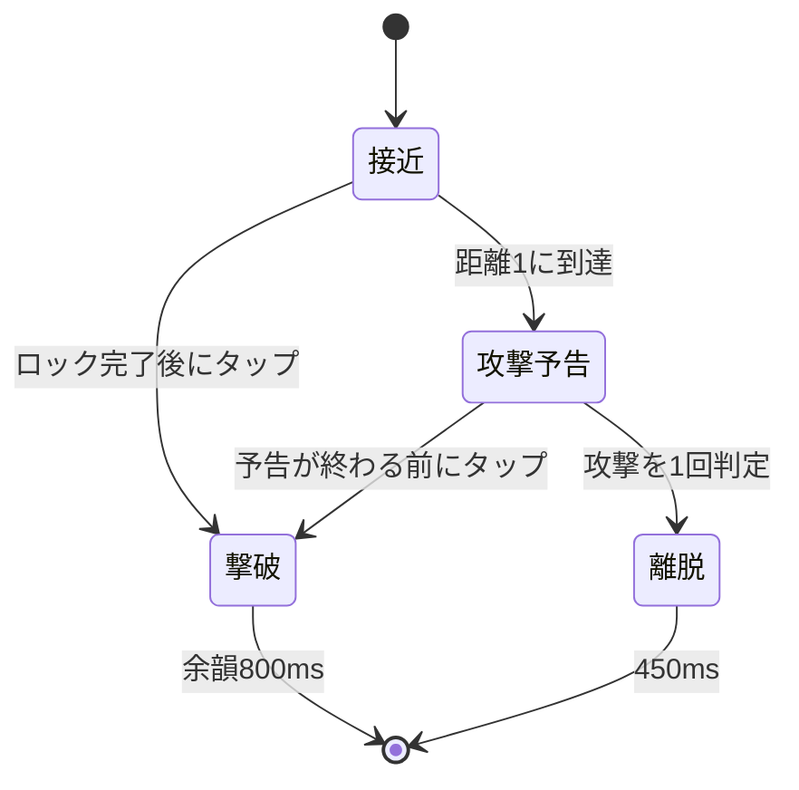
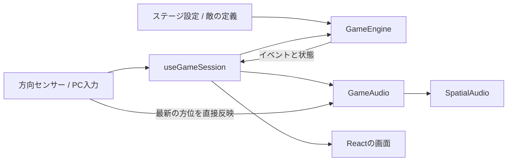

# 戦闘システムとステージ制作

この文書は、現在の実装をメンバーと共有するための仕様です。
高度な敵AIや3D姿勢の作り直しを先に進めず、「音で発見し、倒したと分かる」体験を完成させる方針です。

## 基本ルール

- 方位：0度=正面、+90度=右、-90度=左。距離の単位はゲーム内の共通単位。
- 敵は世界方位を持ち、音響側へ渡すときだけ `relativeAngle(enemyYaw, playerYaw)` を計算する。
- 正面±15度の敵のうち、正面に最も近い1体を選ぶ。同角度なら近距離を優先する。
- 対象が範囲内にいる間は保持する。敵が横切っただけで別の敵へ勝手に切り替えない。
- 選択中の1体だけロックが進む。それ以外のゲージは、満タンから400msで0になる速度で減る。
- ロック完了後にタップすると必ず1体を倒す。連打・同じ敵への二重得点は発生しない。
- 敵は攻撃距離1で予告し、その場で待つ。予告中でも撃破可能。
- 攻撃後は1度だけダメージを判定して離脱。被弾後1600msは無敵。
- 無敵中に別の敵が攻撃しても追加ダメージはない。その敵は離脱し、未撃破数に数える。
- 敵が離脱すると連続撃破は途切れる。撃破できなかった敵もウェーブの残数から除く。
- ライフ0はゲームオーバー。全ウェーブを処理してライフがあればクリア。
- 時間制の練習は60秒で終了。ライフ0なら時間より先にゲームオーバー。

## 敵の初期設定

| kind | 名前 | 接近速度/秒 | 周回速度/秒 | ロック時間 | 予告時間 | 基本点 |
|---|---|---:|---:|---:|---:|---:|
| walker | 足音の主 | 0.1333… | 0度 | 700ms | 1000ms | 100 |
| runner | 駆ける影 | 0.3 | 0度 | 650ms | 850ms | 150 |
| orbiter | さまよう息 | 0.15 | 左右いずれか12度 | 700ms | 1100ms | 180 |

全種1回で倒せます。初期ライフは3、敵の攻撃力は1です。
定義は `src/game/enemies.ts` に集約しています。ステージ側では敵の接近速度と周回速度のみ個別に上書きできます。

連続撃破ボーナスは `min(4, combo - 1) × 25` 点。
1〜5体目の追加点は0・25・50・75・100点で、それ以降も追加100点です。

## 行動と演出



撃破の瞬間に足音・ロック完了音・その敵の予告音を停止します。
中央の命中音と、倒した方向からの消滅音を重ね、画面に撃破・得点・連続数を表示します。
対応端末では短い振動も加えます。撃破後800msは新しい敵を出さず、余韻を残します。
すでに出ている別の敵はこの間も動きます。

SEはWeb Audioのバッファとして事前に合成しており、外部素材のライセンスは増えていません。
敵の足音・呼吸音、ロック音、心音は既存素材を使っています。
将来、敵固有の声へ置き換える場合も `GameAudio.ts` 側で行い、戦闘判定には触れません。

## 責務の境界



- **GameEngine**：ブラウザに依存しない戦闘と状態。乱数関数を差し替えてテスト可能。
- **useGameSession**：ゲーム時計、入力、音声準備、表示更新、一時停止を接続。
- **GameAudio**：戦闘イベントを足音・効果音へ変換。敵の生死や得点は決めない。
- **SpatialAudio**：音声の読み込み、キャッシュ、音源位置、再生・停止。従来APIも維持。
- **画面**：通常プレイでは敵の正確な方向を描かない。開発表示は `?debug=1` のみ。

エンジンの主な操作は `start / update / attack / pause / resume / recenter`。
`snapshot()` は内部から独立した表示用データを返し、`drainEvents()` は未処理イベントを一度だけ返します。
イベントは `spawned / lock-ready / attack-warning / enemy-defeated / player-damaged / wave-started / finished` です。

## 時計と停止

音声は開始前にまとめて読み込みます。読み込み中・3秒の開始合図・一時停止中は戦闘時間を進めません。
戦闘・制限時間・無敵・出現待ちは同じエンジンの経過時間を使用します。
25ms以下の小刻みな更新により、フレーム間隔が多少変わっても攻撃・無敵の順序を保ちます。

タブ非表示、音声の中断、方向データの5秒以上の途絶、1.5秒以上の描画中断で一時停止します。
方向が計算できない姿勢では最後の有効な方向を保ち、長く続くと接続し直す案内を出します。
停止中の音声バッファは保持し、再開時に全音源をダウンロードし直しません。

センサー方位からPannerNodeへの反映はReactの再描画を待ちません。UIだけ約30fpsで更新します。
方向に追加の平滑化は入れていません。既存の低遅延方針を引き継ぎます。

## ステージを追加する

担当者ごとに `src/game/stages/forest.ts` などのファイルを作ります。
まずは見本の `mansion.ts` をコピーし、次の形で編集します。

```typescript
import type { StageDefinition } from "../types.ts";
import { stageDefaults } from "./defaults.ts";

export const forestStage: StageDefinition = {
    ...stageDefaults,
    id: "forest",              // 重複しないID。記録の保存キーにもなる
    name: "第二夜・森",
    subtitle: "THE FOREST",
    description: "木々の間を近づく気配を聞き分ける。",
    hint: "呼吸音は、左右へ回り込む敵の手がかり。",
    difficulty: "標準",
    mode: "waves",
    background: "/images/stages/forest.jpg",
    // ambientSoundUrl: "/sounds/stages/forest-ambient.wav",
    maxConcurrent: 1,
    waves: [
        { name: "木々の間", enemies: [{ kind: "walker" }, { kind: "orbiter" }] },
        { name: "走る気配", enemies: [{ kind: "runner" }, { kind: "orbiter" }] },
    ],
};
```

1. 画像を `public/images/stages/forest.jpg` などに置く。パノラマは横方向に繰り返して表示するため、左右がつながる360度画像が適する。
2. 環境音を使う場合は、ループに適したWAVを `public/sounds/stages/` に置き、`ambientSoundUrl` を設定する。低音量で中央に流れる。足音を隠さない音にする。
3. `src/game/stages.ts` でファイルをimportし、`stages` 配列に追加する。
4. `npm test`、`npm run lint`、`npm run build` を実行し、実機で確認する。
5. 追加素材の出所・利用条件をPRに記載する。

| 設定 | 意味 |
|---|---|
| initialLife | 開始ライフ。1以上の整数 |
| maxConcurrent | 同時に存在できる敵の上限。1〜4。まず1、複数音の調整は2から |
| spawnIntervalMs | 出現間隔の下限。上限数と撃破余韻を満たすまで次の出現を待つ |
| defeatPauseMs | 撃破状態と次の出現までの余韻。標準800ms |
| waveBreakMs | 最後の敵の余韻の後から、次ウェーブの合図までの間。標準2400ms |
| waves | 出現順。全敵の撃破または離脱でウェーブ完了 |
| mode / durationMs | wavesは有限出現、timedは同じ出現リストを繰り返し、時間で終了 |
| background | `mansion` は既存画像。それ以外は背景画像URL |
| ambientSoundUrl | 任意の環境音。未指定なら環境音なし |

最初の出現と各ウェーブの開始合図の後に600msの準備時間があります。
次の出現は厳密な時刻表ではなく「間隔と空き枠に応じた順次出現」です。
設定の数値や敵IDの誤りはエンジン作成時に検証します。

## 分担例

| 担当 | 主に編集する場所 | 共通で相談する変更 |
|---|---|---|
| A：音響・入力 | audio/、sensors/ | 公開API、音の相対方向、音量バランス |
| B：戦闘・UI | GameEngine、useGameSession、components/ | イベント、敵の状態、得点ルール |
| 各ステージ担当 | stages/担当ファイル、public/担当素材 | ステージ登録の1行、既存にない敵やギミック |

全員が同じGameScreenをコピーして別のステージを作る運用は避けます。
敵の種類を増やすときは `EnemyKind` と `enemies.ts`、必要な演出をまとめて更新し、既存ステージにも同じルールを適用します。
複数同時出現は基盤とテストに対応済みですが、見本ステージは聞き分けと撃破の手応えを整えるため1体ずつです。

## 今後、実機で決めたい点

- 命中・消滅・予告・心音の音量比と、素材の長さ。
- 俊敏型の8秒程度の接近時間が、初心者にも対応可能か。
- ロック範囲15度と、範囲外の減衰400msが端末の揺れに対して厳しすぎないか。
- 800msの余韻とウェーブ間隔が、気持ちよさと緊張感の両方を保てるか。
- 2体同時出現を採用するとき、前後の定位と音色を十分に聞き分けられるか。

上下方向の敵、敵の多段HP、複雑な特殊能力、オンラインランキングは今回の共通戦闘基盤には含めていません。
まず現在の3種類と見本ステージを実機で調整してから追加します。
