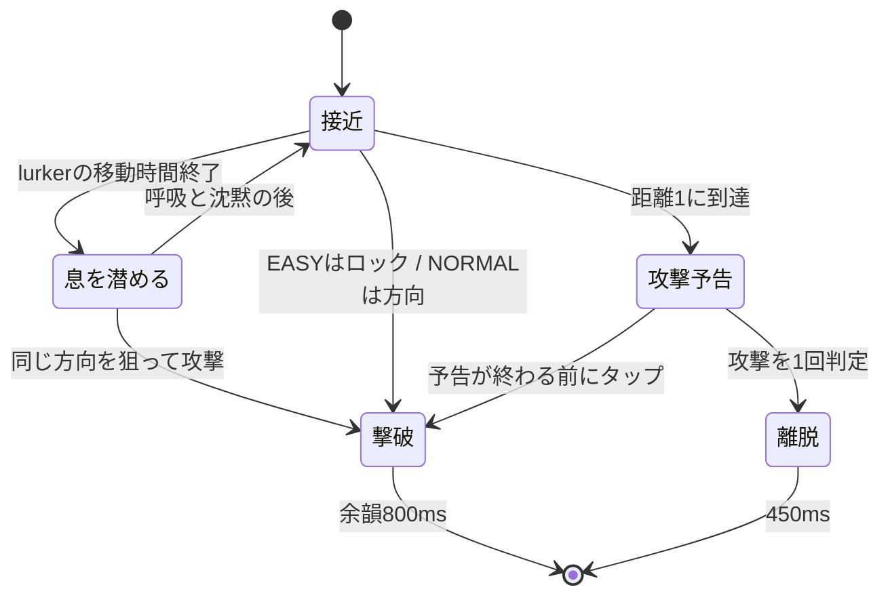
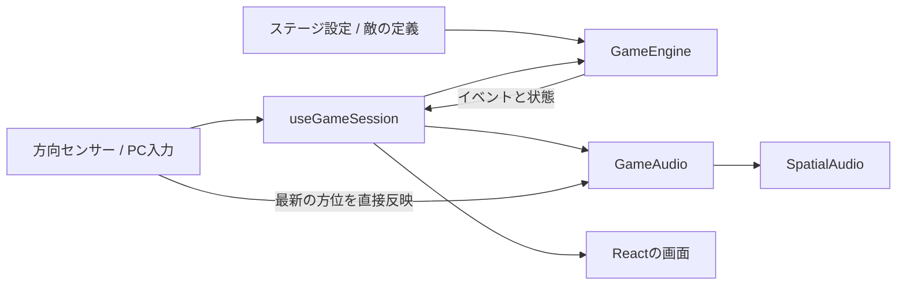

# 戦闘システムとステージ制作

この文書は、現在の実装をメンバーと共有するための仕様です。
高度な敵AIや3D姿勢の作り直しを先に進めず、「音で発見し、倒したと分かる」体験を完成させる方針です。

## 基本ルール

- 方位：0度=正面、+90度=右、-90度=左。距離の単位はゲーム内の共通単位。
- 敵は世界方位を持ち、音響側へ渡すときだけ `relativeAngle(enemyYaw, playerYaw)` を計算する。
- 正面±15度の敵のうち、正面に最も近い1体を選ぶ。同角度なら近距離を優先する。
- EASYは対象が範囲内にいる間は保持する。敵が横切っただけで別の敵へ勝手に切り替えない。
- EASYは選択中の1体だけロックが進む。それ以外のゲージは、満タンから400msで0になる速度で減る。
- EASYはロック完了後にタップすると1体を倒す。NORMALはロックせず、攻撃時の正面±15度を判定する。
- 連打・同じ敵への二重得点は発生しない。NORMALの空振りは650ms、命中は250msの隙を作る。
- 敵は攻撃距離1で予告し、その場で待つ。予告中でも撃破可能。
- 攻撃後は1度だけダメージを判定して離脱。被弾後1600msは無敵。
- 無敵中に別の敵が攻撃しても追加ダメージはない。その敵は離脱し、未撃破数に数える。
- 敵が離脱すると連続撃破は途切れる。撃破できなかった敵もウェーブの残数から除く。
- ライフ0はゲームオーバー。全ウェーブを処理してライフがあればクリア。
- 時間制の練習は60秒で終了。ライフ0なら時間より先にゲームオーバー。

## 難易度と情報の制限

タイトルでEASY/NORMALを選びます。従来のゲージとロック合図はEASYに残しています。
NORMALではロック状態を作らず、照準の色・文言・ゲージ・ボタン可否を敵の位置で変化させません。
ボタンの可否を変えるのは開始・停止・攻撃後の隙だけです。ロック合図音も鳴りません。
この規則は `combatPresentation.ts` と `CombatOverlay.tsx` に集約し、位置を変えても同一HTMLになることをテストします。

NORMALは空振りでもライフや過去の得点を減らしません。連続撃破は0に戻ります。
隙の間も敵は移動します。一時停止すると隙の時間も止まります。
得点・クリア履歴はステージと難易度別です。EASYは従来の保存キーを引き継ぎ、NORMALは別キーを使います。

## 敵の初期設定

| kind | 名前 | 接近速度/秒 | 周回速度/秒 | ロック時間 | 予告時間 | 基本点 |
|---|---|---:|---:|---:|---:|---:|
| walker | 足音の主 | 0.1333… | 0度 | 700ms | 1000ms | 100 |
| runner | 駆ける影 | 0.3 | 0度 | 650ms | 850ms | 150 |
| orbiter | さまよう息 | 0.15 | 左右いずれか12度 | 700ms | 1100ms | 180 |
| lurker | 息を潜めるもの | 0.19 | 0度 | 700ms | 1300ms | 200 |
| warden | 屋敷の主 | 突進時のみ | 最初8度、命中ごとに加速 | 700ms | 1100ms | 最後1000 |

ロック時間はEASYだけで使用します。NORMALの攻撃は方向が合っていれば即座に命中します。
lurkerは2600ms歩き、2200ms停止します。停止中の最初900msだけ呼吸し、残りは沈黙します。
停止中は方位・距離が変わらず、沈黙中も狙った場所に攻撃すれば倒せます。

通常の敵は1回、ボスは3回の命中で倒せます。初期ライフは3、敵の攻撃力は1です。
定義は `src/game/enemies.ts` に集約しています。ステージ側では敵の接近速度と周回速度のみ個別に上書きできます。

連続撃破ボーナスは `min(4, combo - 1) × 25` 点。
1〜5体目の追加点は0・25・50・75・100点で、それ以降も追加100点です。

## 行動と演出



撃破の瞬間に足音・ロック完了音・その敵の予告音を停止します。
中央の命中音と、倒した方向からの消滅音を重ね、画面に撃破・得点・連続数を表示します。
対応端末では短い振動も加えます。撃破後800msは新しい敵を出さず、余韻を残します。
すでに出ている別の敵はこの間も動きます。

## ボス「屋敷の主」

第三夜は通常の敵を挟まず、ボスと単独で戦います。
ボスの処理は `bossBehavior.ts` に分け、通常の接近・捕捉と混ぜない構造です。

1. **守り**：重い足音と鍵の音で移動する。ノーマルで攻撃すると弾かれ、650msの隙になる。イージーはこの間ロックしない。
2. **隙**：鍵の音が止まり、息を吸う。その場で止まるため、音の方向を捉えて攻撃する。ノーマルに狙い目を知らせる画面変化は出さない。
3. **命中後**：体力を1減らし、50点加算。短く立て直した後、80〜140度離れた位置へ移り、再び鍵の音で居場所を知らせる。
4. **攻撃を逃した場合**：1100msの予告の後に1ダメージ。予告中も反撃できる。攻撃後は立て直しに移り、ボスは離脱しない。
5. **3回目の命中**：撃破数を1増やし、1000点加算。1800msの消滅音の余韻を経てクリア。放置だけではクリアにならない。

守りの時間は4200→3750→3300ms。隙はノーマルで2400→2200→2000ms、イージーは各500ms長くします。
命中と攻撃後の立て直しは1200msです。3周期は残り体力から決まり、同じ隙に連打して複数ダメージは入りません。
隙の間はフェイクと環境の怪異を止め、呼吸を聞き分けられる状態にします。
隙の途中で一時停止した場合は、再開時に呼吸音を戻します。隙の残り時間は停止中に進みません。

画面上部にはボスの名前と残り体力だけを表示します。位置・守り・隙に合わせて表示を変えることはありません。
ボス戦のリザルトは命中数・外した攻撃・残りライフ・戦闘時間を表示します。
ボスは単独の有限ウェーブにのみ配置できます。同時出現、時間制、他の敵との混在、速度の個別上書きは設定検証で拒否します。

最終ウェーブの最後の敵が倒れた後は `snapshot.ending` で余韻待ちを表し、追加の攻撃を受け付けません。
撃破後の連打で空振りが増えたり、確定した撃破表示が上書きされたりすることを防ぎます。

## フェイクとホラー演出

第二夜のフェイクは実体のある敵とは別の `Phantom` として管理します。
0・420・840msの3歩を鳴らし、次は2400msまで待つリズムです。距離3.8で固定し、最大1つだけ出します。
本物から最低55度離れた方向に生成し、位置も距離も変えず、呼吸も攻撃もしません。
3歩のリズムと音量が近づかないことが主な手がかりです。本物の通常型も足音だけなので、呼吸がないことだけでは判別できません。

フェイクはロックや撃破の対象にならず、NORMALで狙って攻撃すると普通の空振りです。
生存数・同時出現数・ウェーブ完了条件には数えません。本物を倒すとフェイクも消え、撃破の余韻を守ります。
時間はエンジン内で進め、停止・再校正にも追従します。途中再開時に古い3歩をまとめて鳴らしません。

物音は低いノック、非言語の囁き、扉のきしみの3種類。背後寄りの水平方向から、小さめの音で再生します。
画面にはゆっくり流れる薄い霧、暗がり、一瞬通り過ぎる周辺の影を加えています。
影は敵の位置を示さず、演出自体がライフを奪うこともありません。上下方向は扱いません。
撃破時はフェイクと環境の怪異音を止め、命中・消滅音を明確に残します。
`prefers-reduced-motion` では霧と影の移動を停止します。

SEはWeb Audioのバッファとして事前に合成しており、外部素材のライセンスは増えていません。
敵の足音・呼吸音、ロック音、心音は既存素材を使っています。
将来、敵固有の声へ置き換える場合も `GameAudio.ts` 側で行い、戦闘判定には触れません。

## 責務の境界



- **GameEngine**：ブラウザに依存しない戦闘と状態。乱数関数を差し替えてテスト可能。
- **useGameSession**：ゲーム時計、入力、音声準備、表示更新、一時停止を接続。
- **GameAudio**：戦闘イベントを足音・効果音へ変換。敵の生死や得点は決めない。
- **SpatialAudio**：音声の読み込み、キャッシュ、音源位置、再生・停止。従来APIも維持。
- **画面**：通常プレイでは敵の正確な方向を描かない。開発表示は `?debug=1` のみ。

エンジンの主な操作は `start / update / attack / pause / resume / recenter`。
`snapshot()` は内部から独立した表示用データを返し、`drainEvents()` は未処理イベントを一度だけ返します。
イベントは `spawned / lock-ready / attack-missed / attack-blocked / boss-opening / enemy-hit / haunting / attack-warning / enemy-defeated / player-damaged / wave-started / finished` です。
エンジンのコンストラクターは `new GameEngine(stage, random, difficulty)`。省略時は従来と同じEASYです。

## 時計と停止

音声は開始前にまとめて読み込みます。読み込み中・3秒の開始合図・一時停止中は戦闘時間を進めません。
戦闘・制限時間・無敵・出現待ちは同じエンジンの経過時間を使用します。
25ms以下の小刻みな更新により、フレーム間隔が多少変わっても攻撃・無敵の順序を保ちます。

タブ非表示、音声の中断、方向データの5秒以上の途絶、1.5秒以上の描画中断で一時停止します。
方向が計算できない姿勢では最後の有効な方向を保ち、長く続くと接続し直す案内を出します。
停止中の音声バッファは保持し、再開時に全音源をダウンロードし直しません。

センサー方位からPannerNodeへの反映はReactの再描画を待ちません。UIだけ約30fpsで更新します。
方向に追加の平滑化は入れていません。既存の低遅延方針を引き継ぎます。

## ステージを追加する

担当者ごとに `src/game/stages/forest.ts` などのファイルを作ります。
まずは見本の `mansion.ts` をコピーし、次の形で編集します。

```typescript
import type { StageDefinition } from "../types.ts";
import { stageDefaults } from "./defaults.ts";

export const forestStage: StageDefinition = {
    ...stageDefaults,
    id: "forest",              // 重複しないID。記録の保存キーにもなる
    name: "第二夜・森",
    subtitle: "THE FOREST",
    description: "木々の間を近づく気配を聞き分ける。",
    hint: "呼吸音は、左右へ回り込む敵の手がかり。",
    difficulty: "標準",
    mode: "waves",
    background: "/images/stages/forest.jpg",
    // ambientSoundUrl: "/sounds/stages/forest-ambient.wav",
    maxConcurrent: 1,
    waves: [
        { name: "木々の間", enemies: [{ kind: "walker" }, { kind: "orbiter" }] },
        { name: "走る気配", enemies: [{ kind: "runner" }, { kind: "orbiter" }] },
    ],
};
```

1. 画像を `public/images/stages/forest.jpg` などに置く。パノラマは横方向に繰り返して表示するため、左右がつながる360度画像が適する。
2. 環境音を使う場合は、ループに適したWAVを `public/sounds/stages/` に置き、`ambientSoundUrl` を設定する。低音量で中央に流れる。足音を隠さない音にする。
3. `src/game/stages.ts` でファイルをimportし、`stages` 配列に追加する。
4. `npm test`、`npm run lint`、`npm run build` を実行し、実機で確認する。
5. 追加素材の出所・利用条件をPRに記載する。

| 設定 | 意味 |
|---|---|
| initialLife | 開始ライフ。1以上の整数 |
| maxConcurrent | 同時に存在できる敵の上限。1〜4。まず1、複数音の調整は2から |
| spawnIntervalMs | 出現間隔の下限。上限数と撃破余韻を満たすまで次の出現を待つ |
| defeatPauseMs | 撃破状態と次の出現までの余韻。標準800ms |
| waveBreakMs | 最後の敵の余韻の後から、次ウェーブの合図までの間。標準2400ms |
| waves | 出現順。全敵の撃破または離脱でウェーブ完了 |
| mode / durationMs | wavesは有限出現、timedは同じ出現リストを繰り返し、時間で終了 |
| background | `mansion` は既存画像。それ以外は背景画像URL |
| ambientSoundUrl | 任意の環境音。未指定なら環境音なし |
| haunting | 任意。`fakeIntervalMs`、`fakeLifetimeMs`、`atmosphereIntervalMs`でフェイクと物音を調整 |

`haunting.fakeIntervalMs` と `atmosphereIntervalMs` は0で無効。`fakeLifetimeMs` は正の値を指定します。
設定例は `stages/sealedHall.ts` を参照してください。練習3種には怪異を追加していません。

最初の出現と各ウェーブの開始合図の後に600msの準備時間があります。
次の出現は厳密な時刻表ではなく「間隔と空き枠に応じた順次出現」です。
設定の数値や敵IDの誤りはエンジン作成時に検証します。

## 分担例

| 担当 | 主に編集する場所 | 共通で相談する変更 |
|---|---|---|
| A：音響・入力 | audio/、sensors/ | 公開API、音の相対方向、音量バランス |
| B：戦闘・UI | GameEngine、useGameSession、components/ | イベント、敵の状態、得点ルール |
| 各ステージ担当 | stages/担当ファイル、public/担当素材 | ステージ登録の1行、既存にない敵やギミック |

全員が同じGameScreenをコピーして別のステージを作る運用は避けます。
敵の種類を増やすときは `EnemyKind` と `enemies.ts`、必要な演出をまとめて更新し、既存ステージにも同じルールを適用します。
複数同時出現は基盤とテストに対応済みですが、見本ステージは聞き分けと撃破の手応えを整えるため1体ずつです。

## 今後、実機で決めたい点

- 命中・消滅・予告・心音の音量比と、素材の長さ。
- 俊敏型の8秒程度の接近時間が、初心者にも対応可能か。
- ロック範囲15度と、範囲外の減衰400msが端末の揺れに対して厳しすぎないか。
- 800msの余韻とウェーブ間隔が、気持ちよさと緊張感の両方を保てるか。
- 2体同時出現を採用するとき、前後の定位と音色を十分に聞き分けられるか。

上下方向の敵、オンラインランキングは含めていません。
通常の敵4種とボス、第一夜〜第三夜を実機で調整してから種類を増やします。

## 画面の文言

ブランド名はECHO HUNTのまま、案内と見出しは短い日本語に統一しています。
「プレイ前の確認」「ライフ」「得点」「クリア」のように、操作や結果を直接伝えます。
英語の飾り見出し、操作と関係のない標語、プレイ中の繰り返し表示は足しません。
